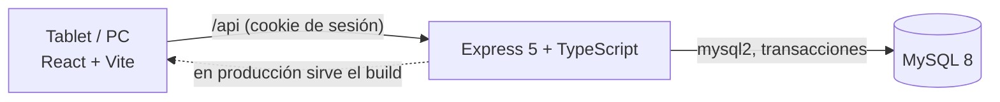

<div align="center">

<picture>
  <source media="(prefers-color-scheme: dark)" srcset="docs/img/logo-white.png">
  
</picture>

### Sistema de gestión para un emprendimiento de velas artesanales

Reemplaza la planilla de Excel del negocio: costos, recetas, stock, ventas y estadísticas en una app web pensada para usarse desde la tablet en la feria.


</div>

---

## El problema

El negocio llevaba todo en un Excel: cuánto cuesta cada insumo, qué lleva cada vela, a cuánto venderla, qué se vendió en la feria del fin de semana. Calcular el costo real de un producto (insumos + mano de obra + packaging + la parte proporcional de luz y gas) era manual y cualquier cambio de precio de un proveedor obligaba a rehacer cuentas.

## Qué hace

| Módulo | Qué resuelve |
|---|---|
| **Insumos y compras** | El precio unitario se calcula solo a partir del envase ($/g de cera, $/ml de esencia). Registrar una compra suma al stock y puede actualizar el precio del insumo. |
| **Packaging** | Catálogo propio de cajas, bolsas, moños y etiquetas con su costo por unidad. Cada producto elige qué lleva y en qué cantidad, así cada uno tiene su costo de packaging. |
| **Recetas** | Cada producto lleva insumos + cantidades. Separadas en **velas** y **aromas**; los insumos se comparten entre ambas. |
| **Costeo y precios** | Costo por unidad = insumos + mano de obra + packaging + gastos fijos prorrateados. Precio sugerido según margen configurable. Si sube un insumo, se recalculan todos los productos que lo usan. |
| **Fabricación** | "Crear 10 velas" aplica la receta, descuenta los insumos y suma el producto al stock. Si falta algo, avisa exactamente qué y cuánto. Se puede deshacer. |
| **Stock** | Por producto **y por aroma**, más el stock de insumos. Nunca puede quedar negativo. |
| **Ventas** | Carga en lote (el cuaderno de la feria se pasa en una sola pantalla), con canal y medio de pago. Solo ofrece lo que hay en stock. |
| **Estadísticas** | Ingresos y unidades por rango de fechas, top productos y aromas, canal, medio de pago y comparación mes a mes. |

## Decisiones técnicas

**El stock nunca queda negativo, y no depende solo del frontend.**
La regla se aplica en tres capas: la UI no deja elegir más de lo disponible, el servidor revisa el lote completo dentro de una transacción con `SELECT … FOR UPDATE` (dos filas del mismo producto suman contra el mismo stock, y dos cargas simultáneas no pueden pasarse) y los descuentos usan `UPDATE … WHERE stock >= ?`, que es atómico. Como última red, la base tiene restricciones `CHECK (stock >= 0)`.

**Todo movimiento de stock es reversible.**
Cada fabricación guarda qué insumos consumió (`production_items`), así deshacerla devuelve exactamente lo usado aunque la receta haya cambiado después. Borrar una venta devuelve las unidades; borrar una compra ya consumida se rechaza con un mensaje claro.

**El costo se calcula, no se guarda.**
Precios unitarios, costos y precios sugeridos salen siempre de los datos actuales, así no hay valores desactualizados que mantener sincronizados.

**Migraciones versionadas.**
Los cambios de esquema son archivos numerados en [`server/db/migrations/`](server/db/migrations/). El servidor aplica los pendientes al arrancar y los registra en `schema_migrations`, igual en desarrollo y en producción.

**Seguridad.**
Contraseñas con `bcrypt`, sesión en cookie `httpOnly` / `sameSite`, `helmet`, consultas parametrizadas en todo el backend, validación de datos en el servidor y manejo de errores centralizado. En producción, la app falla al arrancar si falta `SESSION_SECRET` y MySQL no expone puertos.

**Sin dependencias de más.**
Los gráficos (torta y barras por mes) están hechos a mano en SVG, sin librerías de charts.

## Arquitectura



```
client/                React + TypeScript + Vite
  src/pages/           una pantalla por módulo
  src/components/      layout responsive (menú hamburguesa), gráficos SVG, solapas
server/                Express 5 + TypeScript
  src/routes/          API REST por recurso
  src/config/          conexión, migraciones, movimientos de stock
  db/migrations/       esquema versionado (se aplica solo al arrancar)
docs/PLAN.md           alcance, fases y checklist de producción
```

## Correrlo en local

Solo hace falta [Docker Desktop](https://www.docker.com/products/docker-desktop/).

```bash
git clone https://github.com/<tu-usuario>/tan-bonito.git
cd tan-bonito
docker compose up
```

| | |
|---|---|
| App | http://localhost:5173 (usuario de desarrollo: `jennifer` / `0000`) |
| API | http://localhost:8080/api/health |
| MySQL | `localhost:3307`, usuario `tanbonito` / `0000` (root: `0000`) |

El código se monta en los contenedores y se recarga solo al guardar. Para empezar con la base vacía: `docker compose down -v`.

> Las credenciales de arriba son solo para desarrollo. En producción se generan nuevas en `.env` (ver más abajo).

<details>
<summary><b>Sin Docker</b></summary>

Con Node 22+ y un MySQL 8 propio:

```bash
cd server && cp .env.example .env   # completar las credenciales de MySQL
npm install && npm run dev
```

```bash
cd client && npm install && npm run dev
```
</details>

<details>
<summary><b>Producción (VPS)</b></summary>

1. Instalar Docker en el servidor y clonar el repo.
2. `cp .env.example .env` y completar contraseñas nuevas y un `SESSION_SECRET` largo:
   `node -e "console.log(require('crypto').randomBytes(32).toString('hex'))"`
3. `docker compose -f docker-compose.prod.yml up -d --build`

La imagen es multi-stage: compila el frontend y el backend, y un único proceso de Node sirve la API y la app en `127.0.0.1:8080`. Para HTTPS, poner [Caddy](https://caddyserver.com/) delante (certificado automático):

```
gestion.ejemplo.com.ar {
  reverse_proxy 127.0.0.1:8080
}
```

Actualizar: `git pull && docker compose -f docker-compose.prod.yml up -d --build`

Backup:

```bash
docker compose -f docker-compose.prod.yml exec db sh -c 'mysqldump -uroot -p"$MYSQL_ROOT_PASSWORD" tan_bonito' > backup.sql
```

Checklist completo en [docs/PLAN.md](docs/PLAN.md#checklist-para-pasar-a-producción).
</details>

## Próximos pasos

- [ ] Clientes: registro con QR en el puesto de feria y descuento de cumpleaños por mail o WhatsApp.
- [ ] Facturación electrónica ARCA (monotributo, factura C) desde la venta.
- [ ] Tienda online con Mercado Pago.
- [ ] Exportar a Excel.

---

<div align="center">
Desarrollado por <a href="https://www.linkedin.com/in/mauricio-lionel-duch">Mauricio Lionel Duch</a>
</div>
